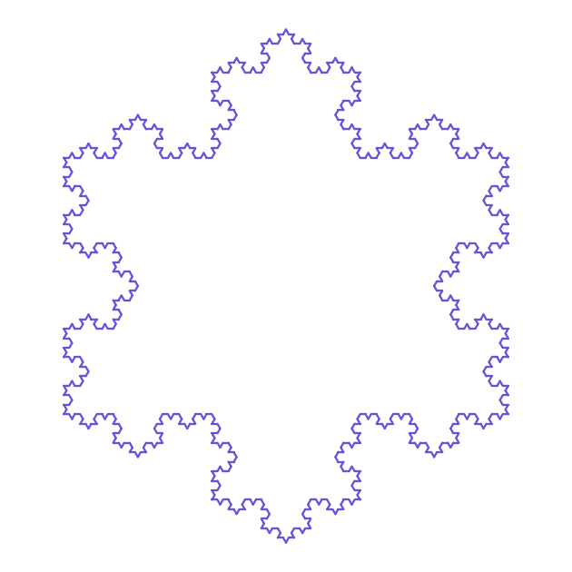

# Fractal Lab · Koch Snowflake

**[▶ Open the live lab](https://izzydi.github.io/koch-fractal/)**

Lab 1 of **[Fractal Lab](https://izzydi.github.io/fractal-lab/)**. Next: [Menger sponge](https://izzydi.github.io/menger-sponge/).

An interactive maths and Python lab for Greek lower-secondary (Gymnasium) students, designed for a single lesson. Students read a commented Python program that draws the Koch snowflake, change the recursion level and colour, and run the code in the browser. No installation or account is needed.

## What students do

- Learn what fractals and self-similarity are, and how Helge von Koch's 1904 construction works.
- Follow the maths step by step: splitting a segment into thirds, the 1/3 and 2/3 points, the 60° peak, the role of √3, and why every segment becomes four.
- Edit `LEVEL` and `COLOR` in a syntax-highlighted editor and run real Python 3, or move the slider to preview levels 0–5 instantly.

## How it works

- One self-contained [`index.html`](index.html), published with GitHub Pages.
- The preview is drawn in JavaScript, so the snowflake appears as soon as the page loads.
- Edited code runs in [Pyodide](https://pyodide.org/), loaded on the first run, so running Python needs an internet connection.
- The page checks the Python output before drawing it: at most 13,000 segments and a named colour.

## Στα ελληνικά

Εκπαιδευτικό εργαστήριο Python για το Γυμνάσιο, για μία διδακτική ώρα. Οι μαθητές γνωρίζουν τα fractals, κατανοούν τα μαθηματικά της χιονονιφάδας Koch και τρέχουν Python απευθείας στον browser, χωρίς εγκατάσταση και χωρίς λογαριασμό.
